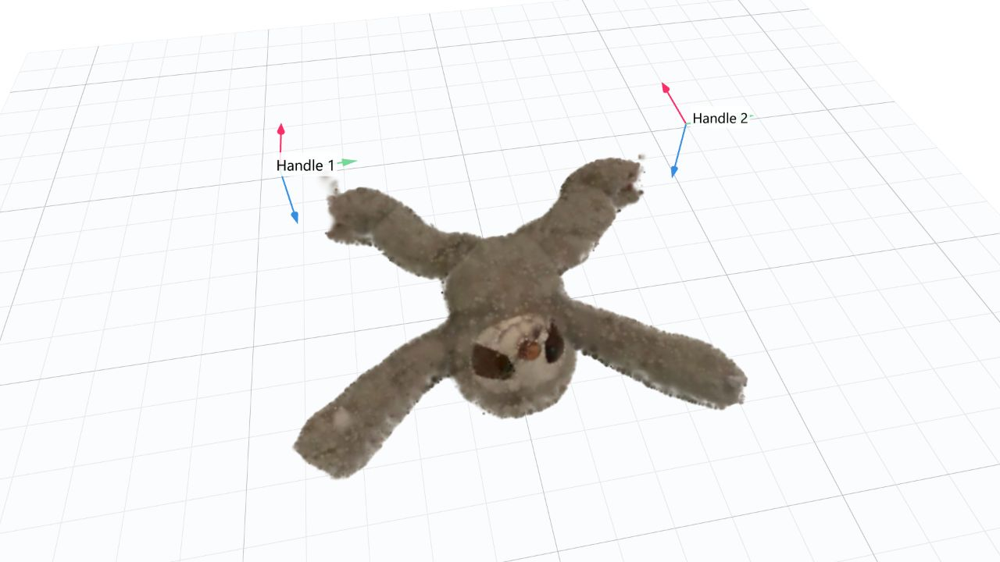

# Deformable plush — PhysTwin

## Run

After completing **First setup** below, double-click **`START_PLUSH.cmd`**
in the repository root and wait for the browser to open. Keep the terminal
window open while using the viewer.

- Drag the coloured handles, or click **Pull both handles**.
- Click **Release grips** to let go. Use **Reset** to start again.
- **Save current view** saves a PNG; **Save pull-and-release video** records
  a short simulation. Files go to `outputs/captures/`.

## Demo



[Pull and release video](../media/plush/sloth_pull_release.mp4)

The object is the authors' prepared `double_stretch_sloth` sample. Its movement
is computed locally with PhysTwin's spring-mass solver and trained parameters;
the browser displays the Gaussian appearance model.

## First setup

Prerequisites for live simulation:

- Git and Python 3.10 (64-bit).
- An NVIDIA CUDA GPU and a compatible NVIDIA driver.

The commands below create an isolated environment and install
[PyTorch 2.5.1 with CUDA 12.1](https://docs.pytorch.org/get-started/previous-versions/)
and Warp 1.6.2. Run them in Windows PowerShell from the folder where you want
to clone the repository.

```powershell
git clone https://github.com/Gklsa/video-to-3d-lab.git
cd video-to-3d-lab/plush-phystwin

py -3.10 -m venv .venv
.\.venv\Scripts\python.exe -m pip install torch==2.5.1 --index-url https://download.pytorch.org/whl/cu121
.\.venv\Scripts\python.exe -m pip install -r requirements-local.txt

git clone https://github.com/Jianghanxiao/PhysTwin upstream
git -C upstream checkout 81c718790a37e5e0102eb77af2c6edd34a9db25f
.\.venv\Scripts\python.exe download_sample.py --output .
.\.venv\Scripts\python.exe view_plush.py --browser
```

The downloader retrieves just this sample from the authors' archives, about
74 MB including archive indexes. Python packages and the source checkout
require additional downloads. It checks the ZIP CRC and records file hashes.
The first run compiles the Warp physics kernels and may take longer to open.

## References

- [PhysTwin, ICCV 2025](https://openaccess.thecvf.com/content/ICCV2025/html/Jiang_PhysTwin_Physics-Informed_Reconstruction_and_Simulation_of_Deformable_Objects_from_Videos_ICCV_2025_paper.html)
- [Official code](https://github.com/Jianghanxiao/PhysTwin)
- [Prepared assets](https://huggingface.co/datasets/Jianghanxiao/PhysTwin/tree/05665bcd0edad8f069c7def9cbb58d2eb75d68d0)
- [Sources and license notes](../THIRD_PARTY_NOTICES.md)
